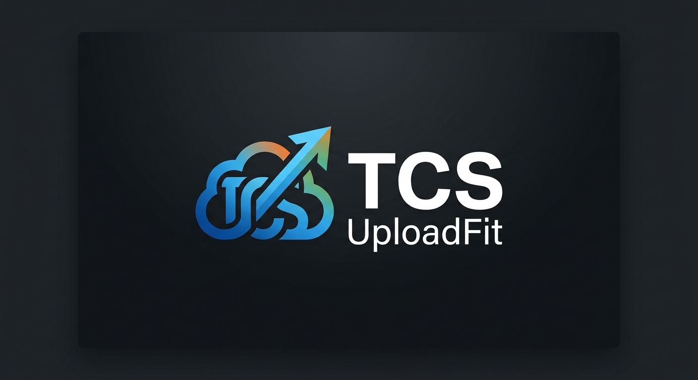

# TCS UploadFit



TCS UploadFit prepares image files locally before they are uploaded to another service. The Windows Store edition includes its web application files inside the MSIX package and opens them through a local WebView2 host. Image content is not uploaded by the app.

## What the current free edition does

- Resize images to a maximum width and height, or create an exact frame using fit, crop, or stretch.
- Convert supported images to JPEG, PNG, or WebP.
- Keep supported JPEG, PNG, or WebP source formats when requested.
- Set JPEG and WebP quality and request a maximum file size. If the requested size cannot be reached at the selected dimensions, the result says so instead of pretending the limit was met.
- Preview the source and prepared output, including dimensions and file size.
- Prepare up to 5 images in one queue and export prepared images in a ZIP file.
- Save local presets and use the English or Indonesian interface.

Current limits: 15 MiB per input image, 20 megapixels per image, 16,000 pixels per output edge, and 40 MiB of prepared output per batch. Supported input signatures include JPEG, PNG, WebP, BMP, and AVIF when the system decoder can read them. Animated GIF and SVG are not supported.

## Privacy

The Store edition has no account, analytics, advertising SDK, or payment feature. Its application files are packaged locally. Selected image files are read and processed on the device; the app does not send image contents to a server. Settings and saved presets are stored in the local WebView2 profile. The original file is not intentionally overwritten.

The host is published self-contained for .NET, but Microsoft Edge WebView2 Evergreen Runtime is a separate Windows runtime dependency. The application files are local in the MSIX; the app does not fetch its HTML, scripts, styles, workers, or image files from a hosted URL. Image preparation works offline once the package and WebView2 Runtime are installed.

## Development

Requirements: Node.js 20 or later and Python 3 for the simple local static server.

```powershell
npm test
npm run build:demo
npm run build:store
npm run serve
```

The web build outputs are written to `dist/demo` and `dist/store`. The demo and its existing Vercel configuration are retained; this repository task does not deploy to Vercel.

## Microsoft Store package

The logo source path is `assets/tcs-uploadfit-logo.jpg`. Keep the original 1408 × 768 owner-supplied image at that exact path. The Store asset generator checks those dimensions and stops rather than creating icons from a wrong-sized replacement. It then creates padded contain versions without modifying the source.

The Store release is built as x64 and x86 MSIX packages, not as an EXE installer:

1. Install the .NET 10 SDK, Windows 10 SDK (for MakeAppx.exe), and Microsoft Edge WebView2 Runtime.
2. The repository already includes `packaging/partner-center.identity.json` with the Product identity values supplied by the owner.
3. Keep the Identity Name, Publisher, and Publisher Display Name unchanged unless Partner Center changes the reserved product identity.
4. Run PowerShell from the repository root:

```powershell
Set-ExecutionPolicy -Scope Process Bypass
.\scripts\build-msix.ps1
```

The output is written to `dist/msix/`. The script creates an unsigned `.msix` and a `.msixupload` ZIP containing that package. No `.appxsym` file is included, so Partner Center crash-symbol analysis is not available for this build. Do not add a private signing certificate for a Microsoft Store submission. The full build and Partner Center steps are in [docs/MSIX-BUILD.md](docs/MSIX-BUILD.md).

